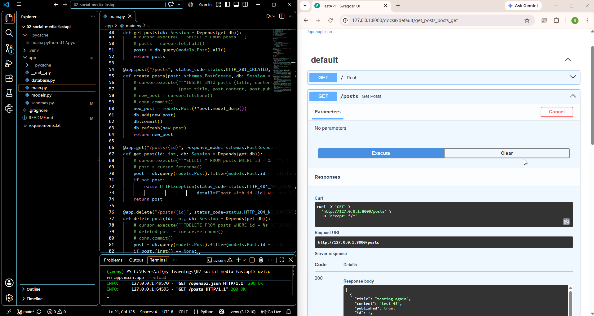

FastAPI + PostgreSQL

(work in progress, Part 1)

My second API project: a social media style API for posts, built with Python and FastAPI, backed by PostgreSQL and tested with Postman.

[](/assets/images/social-media-fastapi-screenshot.png){:target="_blank"}

**Code:** [View the project on GitHub](https://github.com/alexia-be/my-learnings/tree/main/02-social-media-fastapi){:target="_blank"}

## What it does

It's a REST API for posts: you can create, read, update and delete them, and the data is stored in a PostgreSQL database. If you ask for a post that doesn't exist, it returns a 404 error. FastAPI also generates interactive API docs automatically at `/docs`.

## Why I built it

To learn how an API is created from the ground up, and later to learn how to automate API testing with pytest. It's a follow-up to my first project, [Contact book REST API](/learnings/2026/10/23/contact-book-api.html){:target="_blank"}: that one was built with Python alone, and this one adds a real database.

I'm following the course [Python API Development - Comprehensive Course for Beginners by Sanjeev Thiyagarajan](https://www.youtube.com/watch?v=0sOvCWFmrtA){:target="_blank"}. I started on November 1, 2026. Part 1 is done (endpoints, PostgreSQL, SQLAlchemy ORM, response schemas), and I'll keep updating this post as I go.

## Tools

Python, FastAPI, Uvicorn, Pydantic, PostgreSQL, pgAdmin, psycopg2, SQLAlchemy, Postman, VS Code

## How it works

1. **Set up:** I created a project folder and a virtual environment, then installed FastAPI.
2. **First endpoint:** I added `main.py` with a root `GET /` endpoint, started the server with Uvicorn and tested it in the browser. I learned how the path operation decorator (`@app.get("/")`) works.
3. **CRUD endpoints:** I built list, create, get one, update and delete endpoints, and tested them with Postman (saved as a Postman collection). At this stage the data lived in a Python variable.
4. **Validation:** I replaced the raw request body with a Pydantic `BaseModel` (required, optional and default fields) and used `HTTPException` to return the right status code when a post id doesn't exist.
5. **Project structure:** I moved `main.py` into an `app/` package.
6. **Database:** I installed PostgreSQL, created a server, database and table, and practiced basic SQL.
7. **Raw SQL version:** I connected the endpoints to the database with psycopg2, using parameterized queries (`%s`) to protect against SQL injection.
8. **ORM version:** I set up SQLAlchemy (the engine, session and base class in `database.py`, the tables as Python classes in `models.py`) and replaced all the raw SQL with `db.query` calls.
9. **Response schemas:** I moved my Pydantic classes into `schema.py` and added a `response_model` to each endpoint, so only the declared fields are returned to the client.

## Project structure

```
02-social-media-fastapi/
└── app/
    ├── __init__.py   # tells Python this folder is a package
    ├── main.py       # the API endpoints
    ├── database.py   # database connection (engine, session, base class)
    ├── models.py     # ORM models: the tables as Python classes
    └── schema.py     # Pydantic classes: validation and response models
```

## How to run it

1. Clone the repo and go into the project folder:
   ```bash
   git clone https://github.com/alexia-be/my-learnings.git
   cd my-learnings/02-social-media-fastapi
   ```
2. Create and activate a virtual environment:
   ```bash
   python -m venv .venv
   .venv\Scripts\Activate.ps1
   ```
   On macOS/Linux, use `source .venv/bin/activate` instead.
3. Install the dependencies:
   ```bash
   pip install "fastapi[all]"
   pip install psycopg2
   pip install sqlalchemy
   ```
4. Install PostgreSQL from postgresql.org and create an empty database named `02_social_media_fastapi` (I used pgAdmin). The `posts` table is created automatically when the app starts. The app connects to PostgreSQL on localhost with the `postgres` user, so update the connection settings in `app/main.py` and `app/database.py` to match your own setup.
5. Start the server:
   ```bash
   uvicorn app.main:app --reload
   ```
6. The API runs at `http://127.0.0.1:8000`, and the docs are at `http://127.0.0.1:8000/docs`.

## How to use it

| Action | Method | Endpoint |
|---|---|---|
| Hello world | GET | `http://127.0.0.1:8000/` |
| List all posts | GET | `http://127.0.0.1:8000/posts` |
| Create a post (returns 201) | POST | `http://127.0.0.1:8000/posts` |
| Get one post (404 if not found) | GET | `http://127.0.0.1:8000/posts/<id>` |
| Update a post (404 if not found) | PUT | `http://127.0.0.1:8000/posts/<id>` |
| Delete a post (204, or 404 if not found) | DELETE | `http://127.0.0.1:8000/posts/<id>` |

Replace `<id>` with the post's id. I tested every endpoint with Postman and checked the data in pgAdmin. For POST and PUT, I send the post details in the request body as JSON.

## What I learned

- **Building REST APIs:** creating endpoints for the full CRUD cycle and returning proper HTTP status codes with `HTTPException`.
- **Data validation:** using Pydantic to validate request bodies and shape responses, including required, optional and default fields.
- **Databases:** basic SQL, connecting an app to PostgreSQL, and why parameterized queries prevent SQL injection.
- **ORMs:** how SQLAlchemy lets me work with the database through Python objects instead of raw SQL.
- **Separation of concerns:** Pydantic schemas (`schema.py`) describe data as it travels over the API, while ORM models (`models.py`) describe how data is stored in the database.
- **API testing:** testing every endpoint in Postman, organizing requests into a collection, and verifying the data in pgAdmin.
- **Project structure:** organizing code into a Python package.

## Challenges and how I solved them

- **The tutorial is about 5 years old.** Some steps didn't match the current FastAPI documentation, so I followed the latest docs alongside the video and compared the two at each step instead of only copying the tutorial.
- **Deprecated Pydantic code.** The tutorial uses `.dict()` (Pydantic v1), which is deprecated. I replaced it with `.model_dump()` after reading the Pydantic v2 migration guide.
- **Getting stuck.** I try to find the problem myself first, using the docs and my own debugging. If I still can't solve it, I ask Claude.

## Next steps

I'm following the course as far as I can, and I'll update this post as I go. Still to come:

- Users and authentication (JWT)
- Votes and database relationships (joins)
- Database migrations with Alembic
- Automated API testing with pytest